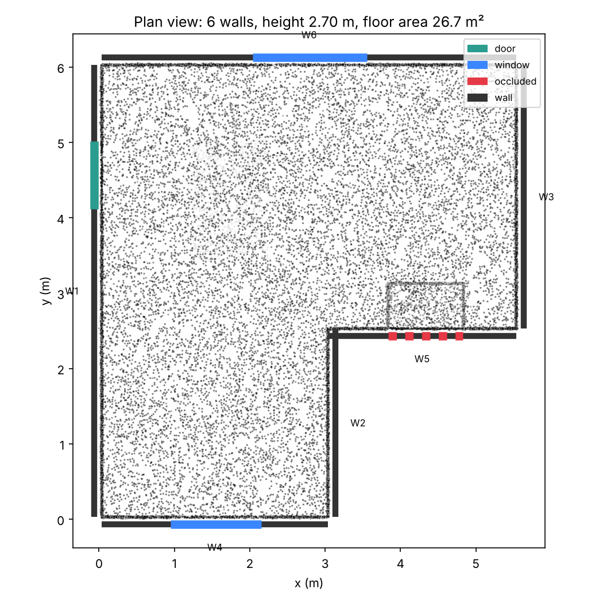
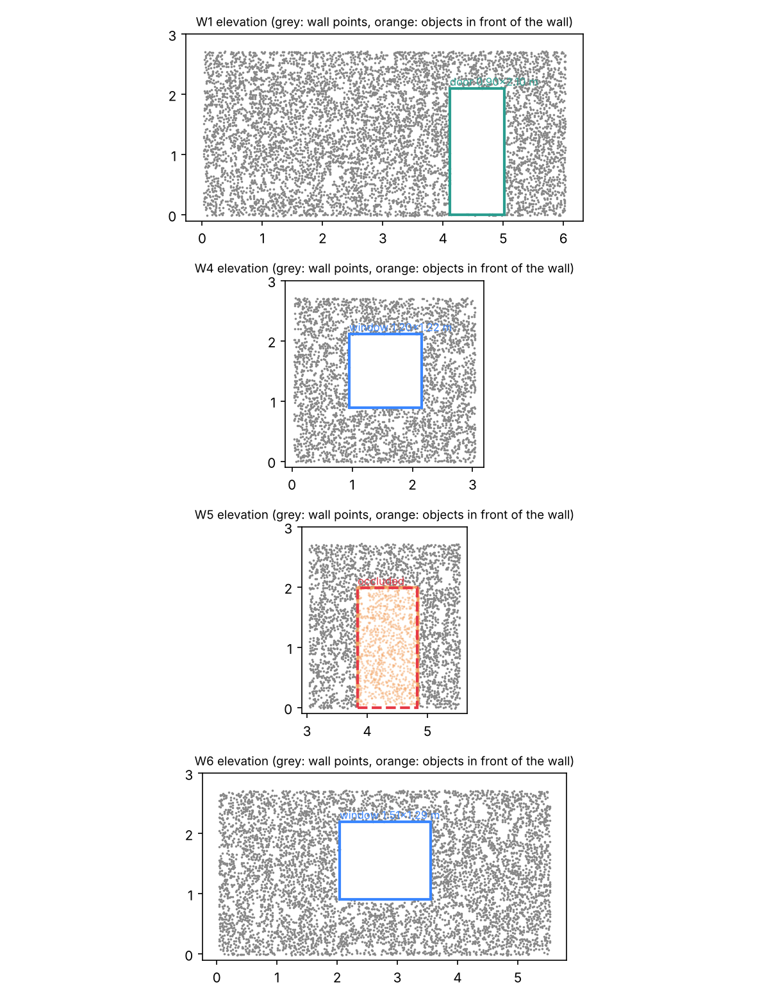
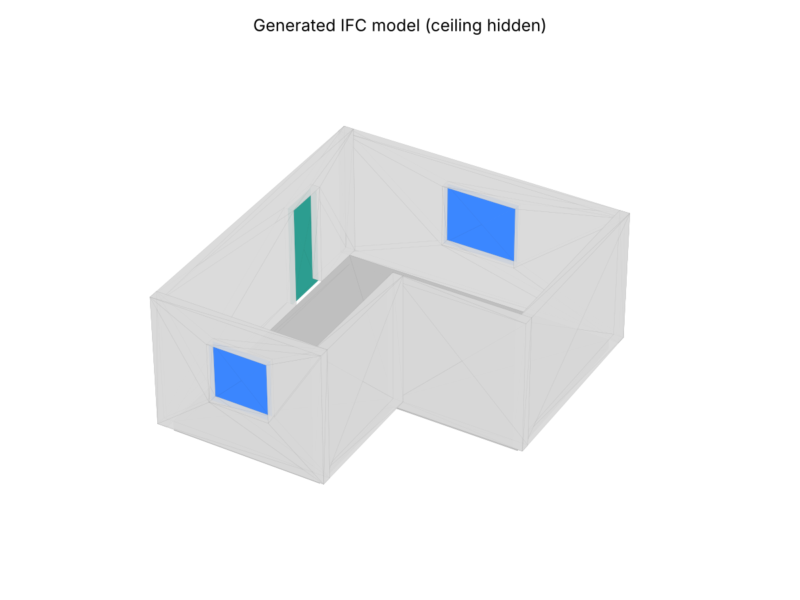

# scan2bim: from a room scan to an IFC building model

A small, readable pipeline that takes a 3D point cloud of an existing room and produces a
building information model (IFC4) with walls, a floor and ceiling slab, and the doors and
windows cut into the walls. Every element records the scan evidence behind it.

It is a geometric baseline, written in plain NumPy so each step can be inspected. The point is
to have a working end-to-end loop, scan in and BIM out with measured error, into which learned
components can later be dropped and compared.



## What it does

| Step | Method | File |
|---|---|---|
| 1. Clean the scan | voxel downsampling, removal of isolated points | `scan2bim/io.py` |
| 2. Find surfaces | sequential RANSAC plane fitting, least-squares refinement, split into connected patches | `scan2bim/planes.py` |
| 3. Floor and ceiling | lowest and highest large horizontal planes | `scan2bim/layout.py` |
| 4. Building axes | dominant wall direction from plane normals (Manhattan assumption, averaged on 4θ) | `scan2bim/layout.py` |
| 5. Walls | vertical planes spanning most of the storey height; interior side found from nearby floor points | `scan2bim/layout.py` |
| 6. Corners | wall ends snapped onto perpendicular walls, then chained into a closed footprint | `scan2bim/layout.py` |
| 7. Doors and windows | empty rectangular regions in a per-wall occupancy grid, edges refined to the nearest points | `scan2bim/layout.py` |
| 8. Occlusion check | a hole with scanned objects just in front of it is marked *occluded*, not an opening | `scan2bim/layout.py` |
| 9. BIM export | IFC4 via IfcOpenShell: `IfcWall`, `IfcOpeningElement`, `IfcDoor`, `IfcWindow`, `IfcSlab` | `scan2bim/ifc_export.py` |

Step 8 matters in practice. A cabinet standing against a wall hides the wall from the scanner and
leaves a door-shaped hole in the data. Without the check the model gets a false door; with it, the
region is flagged as unknown instead.





## Results on synthetic scans

The synthetic scene (`scan2bim/synth.py`) is an L-shaped room 2.70 m high with one door, two windows,
a table and a 2 m cabinet against one wall. It is rotated and shifted randomly, has Gaussian sensor
noise and stray points, and comes with exact ground truth.

`python -m scan2bim.benchmark --seeds 10`:

| noise (cm) | runs | footprint closed | corner error (cm) | openings found / true | false openings | opening size error (cm) |
|---|---|---|---|---|---|---|
| 0.5 | 10 | 10/10 | 0.0 | 30/30 | 0 | 1.1 |
| 1.0 | 10 | 10/10 | 0.1 | 30/30 | 0 | 1.5 |
| 2.0 | 10 | 10/10 | 0.4 | 30/30 | 0 | 2.6 |
| 3.0 | 10 | 10/10 | 0.7 | 30/30 | 0 | 3.9 |

These numbers are optimistic: every run uses the same room layout, the walls are perfectly flat, and
the clutter is simple. They show that the pipeline is correct, not that it generalises. Real scans are
the real test (see below).

## Run it

```bash
python -m venv .venv && source .venv/bin/activate      # Windows: .venv\Scripts\activate
pip install -r requirements.txt

python -m scan2bim.synth --out data/synthetic_room.ply  # make a test scan with ground truth
python -m scan2bim.run data/synthetic_room.ply --out output/synthetic
```

Outputs in `output/synthetic/`: `model.ifc` (open it in Revit, BlenderBIM/Bonsai, or the free
viewer at https://ifcviewer.com), `plan.png`, `elevations.png`, `model_3d.png`, and
`evaluation.json` when ground truth is available.

### On your own room

1. **Capture.** A phone with LiDAR (recent iPhone Pro or iPad Pro) and an app such as Polycam,
   Scaniverse or 3D Scanner App gives metric point clouds directly; export as PLY. Without LiDAR, take
   80–150 overlapping photos and reconstruct with COLMAP or Meshroom. Photogrammetry has no absolute
   scale, so measure one wall with a tape and pass the correction with `--scale`.
2. **Run.**
   ```bash
   python -m scan2bim.run my_room.ply --up y --voxel 0.02 --out output/my_room
   ```
   `--up y` is needed for most phone exports. On noisy scans raise `--threshold` (e.g. 0.05).
3. **Check** `plan.png` first: if walls are missing, lower `--min-points`; if furniture becomes walls,
   the room is probably cluttered above 85 % of the ceiling height.

## Limitations

- One storey, one room, vertical walls at right angles, flat floor and ceiling.
- Wall thickness is assumed (`--thickness`), because a single interior scan sees only one face.
- Holes are detected geometrically, so a large glass pane that the scanner sees through and an
  open doorway look the same; a mirror or a dark surface that returns no points looks like an opening.
- Furniture is ignored, not modelled.

## Where learning fits

The geometric baseline gives the loop and the metrics. The open problems are exactly where it relies
on hand-written rules:

1. **Semantic segmentation of points** (e.g. Point Transformer, trained on S3DIS or ScanNet) instead of
   "tall vertical plane = wall", which breaks for half-height partitions, curved walls and heavy clutter.
2. **Vision-language models on the source photos** to label what a geometric hole is (door, window,
   glazed partition, mirror) and to read attributes the geometry cannot give: materials, fire doors,
   radiators.
3. **Generative completion of occluded regions**: proposing what lies behind a cabinet, with an
   explicit uncertainty, rather than only flagging it.
4. **Uncertainty in the BIM itself**: the `Scan2BIM_Evidence` property sets are a first step; an
   engineer reusing a building needs to know which dimensions were measured and which were inferred.

## How this was built

I wrote this prototype with an AI coding assistant (Claude) while preparing a PhD application in
reality capture for BIM. The assistant wrote most of the code; I set the goal, ran and tested it, and
worked through each step to understand the methods. The structure is kept simple on purpose so every
step can be read and changed.

## Layout

```
scan2bim/
  io.py          PLY reading/writing, downsampling, outlier removal
  synth.py       synthetic room generator with ground truth
  planes.py      sequential RANSAC plane detection
  layout.py      floor, ceiling, walls, corners, openings, occlusion check
  ifc_export.py  IFC4 export with IfcOpenShell
  visualize.py   plan, elevation and 3D figures
  evaluate.py    scoring against ground truth
  benchmark.py   noise robustness table
  run.py         command-line entry point
```
